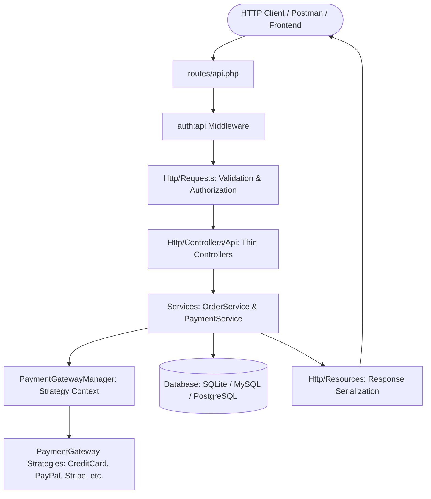
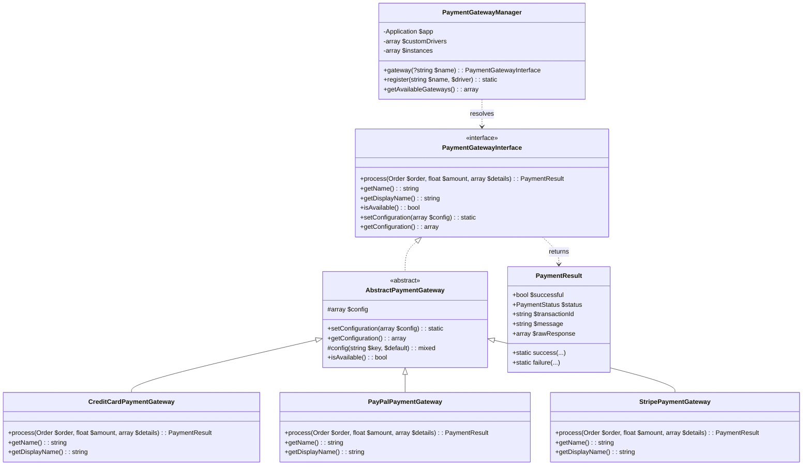
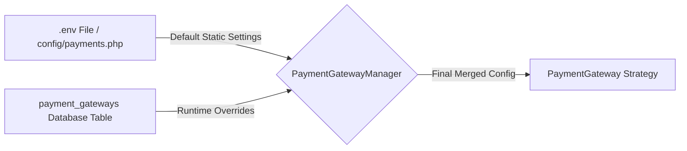
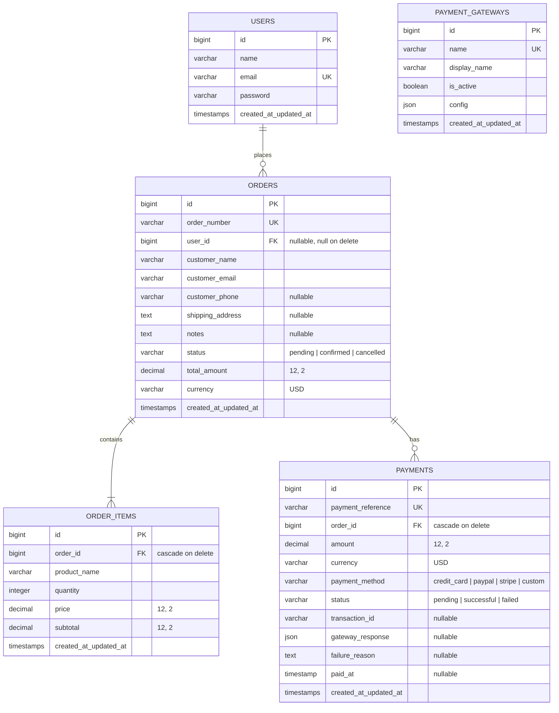
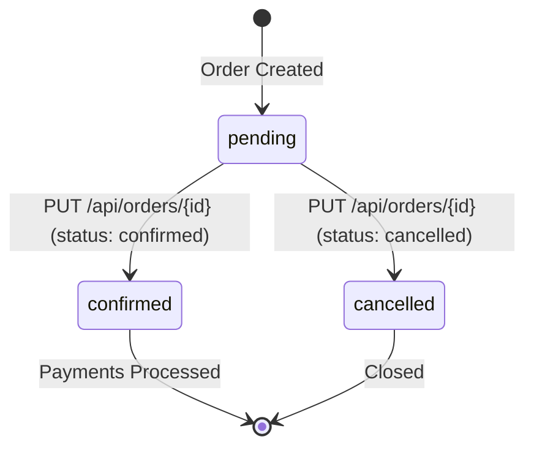
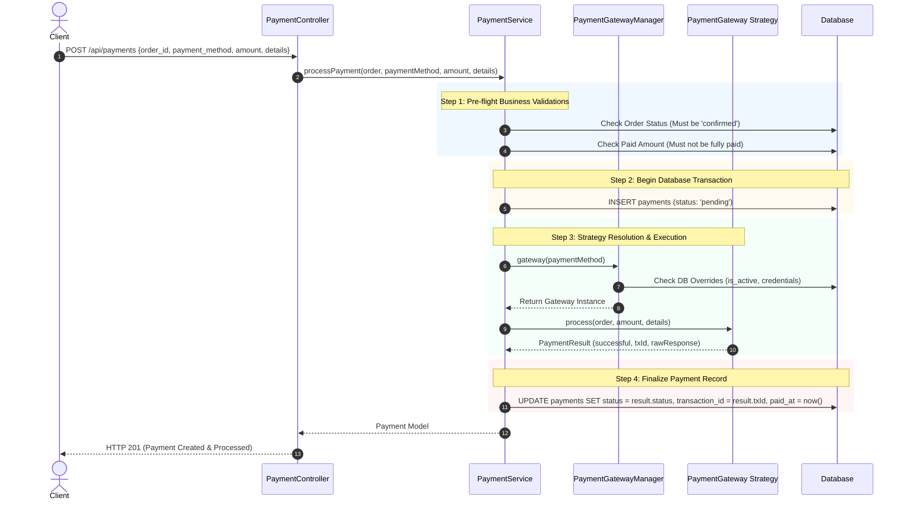

# Extendable Order & Payment Management API — Comprehensive System Guide

This document provides a thorough, architectural, and operational explanation of what this project does, why it was designed this way, and exactly how it works under the hood.

---

## Table of Contents
1. [Executive Summary](#1-executive-summary)
2. [What the Project Does (Core Capabilities)](#2-what-the-project-does-core-capabilities)
3. [System Architecture & Design Patterns](#3-system-architecture--design-patterns)
   - [Layered Architecture](#31-layered-architecture)
   - [Strategy Pattern for Payment Gateways](#32-the-strategy-pattern-for-payment-gateways)
   - [Dual-Layer Configuration (ENV + Database)](#33-dual-layer-configuration-system)
4. [Domain Entities & Database Design (ERD)](#4-domain-entities--database-design-erd)
5. [How It Works: Step-by-Step Lifecycles](#5-how-it-works-step-by-step-lifecycles)
   - [Lifecycle 1: Authentication & JWT Management](#lifecycle-1-authentication--jwt-token-management)
   - [Lifecycle 2: Order Creation & Calculation](#lifecycle-2-order-creation--financial-calculation)
   - [Lifecycle 3: Order Status Progression](#lifecycle-3-order-status-progression)
   - [Lifecycle 4: Payment Orchestration & Gateway Dispatch](#lifecycle-4-payment-orchestration--gateway-dispatch)
   - [Lifecycle 5: Data Integrity & Protected Deletion](#lifecycle-5-data-integrity--protected-deletion)
6. [Business Rules & Validation Engine](#6-business-rules--validation-engine)
7. [Payment Gateways & Simulation Specs](#7-payment-gateways--simulation-specs)
8. [Extensibility Guide: How to Add a New Gateway](#8-extensibility-guide-how-to-add-a-new-gateway)
9. [Complete API Route Map](#9-complete-api-route-map)
10. [End-to-End Walkthrough Example](#10-end-to-end-walkthrough-example)
11. [Testing & Quality Assurance](#11-testing--quality-assurance)

---

## 1. Executive Summary

The **Extendable Order & Payment Management API** is an enterprise-grade backend service built with **PHP 8.2+** and **Laravel 12**. 

Its primary purpose is to provide a reliable, modular, and auditable foundation for handling **e-commerce orders and multi-provider financial payments**. It solves common pitfalls in financial APIs:
- **Tightly-Coupled Gateways**: Changing or adding a payment gateway in typical systems requires modifying controllers and database schemas. This project eliminates that friction using the **Strategy Design Pattern** and a dynamic **Payment Gateway Manager**.
- **Data Inconsistencies & Fraud**: Orders cannot accept payments unless explicitly confirmed, cannot be modified once paid, and cannot be accidentally deleted if financial records exist.
- **Config Downtime**: Payment gateways can be enabled, disabled, or reconfigured dynamically in the database without code redeployments or server restarts.

---

## 2. What the Project Does (Core Capabilities)

### 1. Order Management
- Accepts customer orders containing multiple line items (product name, quantity, unit price).
- Automatically calculates line item subtotals and the overall order grand total with financial 2-decimal precision.
- Issues unique, human-readable identifiers for each order (e.g. `ORD-20261022-A1B2C3D4`).
- Supports pagination and filtering of orders by status (`pending`, `confirmed`, `cancelled`).
- Maintains order relationships with users, line items, and payment transactions.

### 2. Extensible Multi-Gateway Payment Processing
- Executes simulated payments across multiple payment providers:
  - **Credit Card** (`credit_card`)
  - **PayPal** (`paypal`)
  - **Stripe** (`stripe`)
- Provides plug-and-play capability to register custom drivers (e.g., Apple Pay, Klarna, Crypto) with zero changes to existing controllers or core logic.
- Maintains full transaction history, idempotency references, timestamps, and gateway payloads for auditing.

### 3. Dynamic Gateway Management
- Allows system administrators to toggle payment gateways on/off at runtime.
- Allows live credential updates (API keys, modes, webhook secrets) stored in the database which cleanly override static `.env` configuration.

### 4. Stateless JWT Authentication
- Implements stateless JSON Web Token (JWT) authentication using `php-open-source-saver/jwt-auth`.
- Provides user registration, login, profile inspection (`/me`), token refresh, and token invalidation (`/logout`).

---

## 3. System Architecture & Design Patterns

### 3.1 Layered Architecture

The application strictly separates responsibilities to maintain a clean codebase (PSR-12 compliant):



- **Slim API Controllers** (`OrderController`, `PaymentController`, `AuthController`): Responsible solely for HTTP transport, parameter extraction, and delegating execution to the service layer.
- **Form Request Layer** (`Http/Requests/*`): Validates input types, formats, required fields, and rules before code reaches the controllers.
- **Domain Service Layer** (`OrderService`, `PaymentService`): Encapsulates business logic, database transactions (`DB::transaction`), financial calculations, and state machines.
- **Resource Layer** (`Http/Resources/*`): Transforms Eloquent models into standard, predictable JSON response representations.

---

### 3.2 The Strategy Pattern for Payment Gateways

The payment sub-system is modeled using the **Strategy Pattern**. This pattern enables selecting payment processing algorithms dynamically at runtime without modifying client code.



#### Responsibilities of the Strategy Components:
1. **`PaymentGatewayInterface`**: The contract defining the essential methods every gateway must implement (`process`, `getName`, `getDisplayName`, `isAvailable`, `setConfiguration`).
2. **`AbstractPaymentGateway`**: An abstract class providing default behavior for configuration retrieval and availability checking.
3. **`CreditCardPaymentGateway`, `PayPalPaymentGateway`, `StripePaymentGateway`**: Concrete strategy implementations that handle provider-specific logic, verification, and mock API simulation.
4. **`PaymentResult` (Value Object / DTO)**: A normalized response format returned by any gateway, decoupling the database from specific provider payload formats.
5. **`PaymentGatewayManager` (Context & Factory)**: Resolves the appropriate strategy based on the client's requested `payment_method`, merges configuration sources, checks driver availability, and caches active gateway instances.

---

### 3.3 Dual-Layer Configuration System

Gateway configuration follows a two-tiered priority system:



1. **Tier 1 (Base Defaults)**: Static settings defined in `config/payments.php` populated from `.env` (e.g. `PAYMENT_CREDIT_CARD_ENABLED=true`).
2. **Tier 2 (Database Overrides)**: If a gateway is recorded in the `payment_gateways` database table, its `is_active` flag and custom `config` JSON column take immediate precedence.
3. **Safety Fallback**: If a gateway is flagged `is_active: false` in the database, any payment attempt targeting that gateway will fail with an `UnsupportedPaymentGatewayException` (HTTP 422).

---

## 4. Domain Entities & Database Design (ERD)

The database schema is designed for consistency, referential integrity, and complete audit logging:



---

## 5. How It Works: Step-by-Step Lifecycles

### Lifecycle 1: Authentication & JWT Token Management
1. **Registration / Login**: The user sends credentials (`email`, `password`) to `/api/auth/login` or `/api/auth/register`.
2. **Token Issuance**: `tymon/jwt-auth` generates a signed JSON Web Token containing the user's ID (`sub`), issue time (`iat`), and expiry (`exp`, default 60 minutes).
3. **Subsequent Calls**: For any protected endpoint (`/api/orders`, `/api/payments`), the client includes the token in the HTTP header:
   ```http
   Authorization: Bearer <jwt_token>
   ```
4. **Token Refresh & Logout**: The client can refresh an expiring token via `/api/auth/refresh` or revoke it via `/api/auth/logout` (which places the token on the JWT blacklist).

---

### Lifecycle 2: Order Creation & Financial Calculation
1. **Client Request**: Client submits customer information and an array of items:
   ```json
   {
       "customer_name": "Alice Johnson",
       "customer_email": "alice@example.com",
       "items": [
           { "product_name": "Keyboard", "quantity": 1, "price": 100.00 },
           { "product_name": "Mouse", "quantity": 2, "price": 25.00 }
       ]
   }
   ```
2. **Validation**: `CreateOrderRequest` ensures customer details exist and at least one valid item is provided with positive `quantity` and non-negative `price`.
3. **Transactional Calculation** (`OrderService::createOrder`):
   - Generates a unique order number: `ORD-{YYYYMMDD}-{8_CHAR_RANDOM}`.
   - Computes each item subtotal: $\text{subtotal} = \text{round}(\text{quantity} \times \text{price}, 2)$.
   - Sums all subtotals into $\text{total\_amount} = 100.00 + 50.00 = 150.00$.
   - Inserts order record with initial status `pending`.
   - Inserts child records into `order_items`.
4. **Response**: Returns HTTP 201 with the created order and computed totals.

---

### Lifecycle 3: Order Status Progression



- When created, orders start in `pending`.
- **Key Rule**: Orders **cannot** be paid while in `pending` or `cancelled`.
- To enable payments, the order must be transitioned to `confirmed` status via `PUT /api/orders/{id}`:
  ```json
  { "status": "confirmed" }
  ```

---

### Lifecycle 4: Payment Orchestration & Gateway Dispatch

When a client initiates a payment via `POST /api/payments`:



1. **Pre-flight Checks**:
   - Order status must be strictly `confirmed`.
   - Order must not already be fully paid ($\sum \text{successful payments} < \text{total amount}$).
   - Charge amount must be $> 0$ (defaults to remaining balance if omitted).
2. **Pending Audit Record**: A row in `payments` is created with status `pending` and a unique `payment_reference` (`PAY-{YYYYMMDD}-{RANDOM}`).
3. **Gateway Resolution**: `PaymentGatewayManager` resolves the concrete driver (`CreditCard`, `PayPal`, `Stripe`) configured for that method.
4. **Strategy Execution**: The gateway strategy runs its processing logic.
5. **Result Synchronization**:
   - If successful: `status` is set to `successful`, `transaction_id` is stored, and `paid_at` timestamp is set.
   - If declined/failed: `status` is set to `failed`, `failure_reason` is recorded, and raw response payload is stored for auditing.

---

### Lifecycle 5: Data Integrity & Protected Deletion

Financial and inventory integrity are protected by strict deletion and edit boundaries:

```mermaid
flowchart TD
    A[DELETE /api/orders/{id}] --> B{Does Order Have Any Associated Payments?}
    B -- Yes --> C[Throw OrderDeletionException: HTTP 422 Rejection]
    B -- No --> D[Delete Order Items & Delete Order: HTTP 200 Success]
```

- **Deletion Guard**: `DELETE /api/orders/{id}` verifies whether any payments (pending, successful, or failed) are linked to the order. If any payment exists, deletion is rejected with `HTTP 422`.
- **Item Modification Guard**: Once an order has payments attached, modifying or replacing its line items via `PUT /api/orders/{id}` is strictly blocked to prevent altering invoices after charging.

---

## 6. Business Rules & Validation Engine

| Rule # | Business Rule | Trigger | Enforcement Point | Result / Error Code |
|---|---|---|---|---|
| **BR-01** | **Order Confirmation Required** | Attempting payment on `pending` or `cancelled` order | `PaymentService::processPayment` | `HTTP 422 Unprocessable Content`<br>`"Payments can only be processed for orders in the 'confirmed' status."` |
| **BR-02** | **Duplicate / Overpayment Prevention** | Attempting payment on already fully paid order | `PaymentService::processPayment` | `HTTP 422 Unprocessable Content`<br>`"Order #ORD-... is already fully paid."` |
| **BR-03** | **Order Deletion Protection** | Attempting to delete an order that has any payments | `OrderService::deleteOrder` | `HTTP 422 Unprocessable Content`<br>`"Order #ORD-... cannot be deleted because it has associated payments."` |
| **BR-04** | **Item Immutability Post-Payment** | Attempting to edit line items on an order with payments | `OrderService::updateOrder` | `HTTP 422 Unprocessable Content`<br>`"Cannot modify order items because this order already has associated payments."` |
| **BR-05** | **Gateway Availability & DB Deactivation** | Attempting payment using an unknown or disabled gateway | `PaymentGatewayManager::resolve` | `HTTP 422 Unprocessable Content`<br>`"Payment gateway '...' is not supported or inactive."` |
| **BR-06** | **Mandatory Items on Order Creation** | Creating an order with 0 items | `CreateOrderRequest` | `HTTP 422 Unprocessable Content`<br>Validation error: `"The items field is required."` |

---

## 7. Payment Gateways & Simulation Specs

The API comes with three built-in payment gateway strategies:

### 1. Credit Card (`credit_card`)
- **Required Details**: `card_number`, `exp_month`, `exp_year`, `cvv`.
- **Success Simulation**: Any valid 16-digit card number.
- **Decline Simulation**: 
  - Card number ending in `0000` (e.g. `4111111111110000`).
  - Or passing `"simulate_failure": true` in `details`.

### 2. PayPal (`paypal`)
- **Required Details**: `payer_email`.
- **Success Simulation**: Standard valid email address.
- **Decline Simulation**:
  - Any email containing the word `fail` (e.g., `payer_fail@example.com`).
  - Or passing `"simulate_failure": true` in `details`.

### 3. Stripe (`stripe`)
- **Required Details**: `payment_method_id` (token).
- **Success Simulation**: Valid token string (e.g., `pm_card_visa`).
- **Decline Simulation**:
  - Token equal to `tok_chargeDeclined`.
  - Or passing `"simulate_failure": true` in `details`.

---

## 8. Extensibility Guide: How to Add a New Gateway

Adding a new payment gateway takes less than two minutes and requires **zero modifications** to controllers or order processing logic.

### Step 1: Create the Gateway Class
Create `app/Services/Payment/Gateways/CryptoPaymentGateway.php`:

```php
namespace App\Services\Payment\Gateways;

use App\Models\Order;
use App\Services\Payment\DTOs\PaymentResult;
use Illuminate\Support\Str;

class CryptoPaymentGateway extends AbstractPaymentGateway
{
    public function getName(): string
    {
        return 'crypto';
    }

    public function getDisplayName(): string
    {
        return $this->config('display_name', 'Cryptocurrency (USDC / ETH)');
    }

    public function process(Order $order, float $amount, array $details = []): PaymentResult
    {
        $wallet = $details['wallet_address'] ?? null;

        if (!$wallet) {
            return PaymentResult::failure('Wallet address is required for cryptocurrency payments.');
        }

        // Simulate successful transaction hash
        $txHash = '0x' . Str::random(64);

        return PaymentResult::success(
            transactionId: $txHash,
            message: 'Crypto payment confirmed on network.',
            rawResponse: ['tx_hash' => $txHash, 'network' => $this->config('network', 'Polygon')]
        );
    }
}
```

### Step 2: Register the Gateway
#### Option A — In `config/payments.php`:
```php
'gateways' => [
    // ...
    'crypto' => [
        'driver' => \App\Services\Payment\Gateways\CryptoPaymentGateway::class,
        'display_name' => 'Cryptocurrency',
        'enabled' => env('PAYMENT_CRYPTO_ENABLED', true),
        'network' => 'Polygon',
    ],
],
```

#### Option B — Dynamically in any ServiceProvider:
```php
app(\App\Services\Payment\PaymentGatewayManager::class)->register(
    'crypto',
    \App\Services\Payment\Gateways\CryptoPaymentGateway::class
);
```

The new payment gateway is instantly accessible via `POST /api/payments` using `"payment_method": "crypto"`.

---

## 9. Complete API Route Map

All protected endpoints require `Authorization: Bearer <token>`.

### Authentication Endpoints
| HTTP Method | Route | Description | Auth Required |
|---|---|---|---|
| `POST` | `/api/auth/register` | Register a new user | No (Public) |
| `POST` | `/api/auth/login` | Authenticate user & retrieve JWT token | No (Public) |
| `GET` | `/api/auth/me` | Fetch authenticated user profile | Yes (`auth:api`) |
| `POST` | `/api/auth/refresh` | Refresh an active JWT token | Yes (`auth:api`) |
| `POST` | `/api/auth/logout` | Invalidate / blacklist active JWT token | Yes (`auth:api`) |

### Orders Endpoints
| HTTP Method | Route | Description | Auth Required |
|---|---|---|---|
| `GET` | `/api/orders` | List orders (paginated, filterable by `?status=`) | Yes (`auth:api`) |
| `POST` | `/api/orders` | Create an order with line items | Yes (`auth:api`) |
| `GET` | `/api/orders/{id}` | View single order with items and payment history | Yes (`auth:api`) |
| `PUT` | `/api/orders/{id}` | Update order status or customer details | Yes (`auth:api`) |
| `DELETE` | `/api/orders/{id}` | Delete order (only if zero payments exist) | Yes (`auth:api`) |
| `GET` | `/api/orders/{id}/payments` | Retrieve payment history for specific order | Yes (`auth:api`) |

### Payments Endpoints
| HTTP Method | Route | Description | Auth Required |
|---|---|---|---|
| `GET` | `/api/payments` | List all payment transactions (paginated) | Yes (`auth:api`) |
| `POST` | `/api/payments` | Process a payment against an order | Yes (`auth:api`) |
| `GET` | `/api/payments/{id}` | View details of a specific payment transaction | Yes (`auth:api`) |

### Payment Gateway Management Endpoints
| HTTP Method | Route | Description | Auth Required |
|---|---|---|---|
| `GET` | `/api/payment-gateways` | List available registered gateways | Yes (`auth:api`) |
| `POST` | `/api/payment-gateways` | Save or toggle gateway configuration in DB | Yes (`auth:api`) |

---

## 10. End-to-End Walkthrough Example

Here is a typical workflow from user login to order payment:

### Step 1: Login
```bash
curl -X POST http://127.0.0.1:8000/api/auth/login \
  -H "Content-Type: application/json" \
  -d '{"email": "admin@example.com", "password": "password123"}'
```
*Extract the `token` from the JSON response and set as `TOKEN` variable.*

### Step 2: Create an Order
```bash
curl -X POST http://127.0.0.1:8000/api/orders \
  -H "Authorization: Bearer $TOKEN" \
  -H "Content-Type: application/json" \
  -d '{
    "customer_name": "John Doe",
    "customer_email": "john@example.com",
    "customer_phone": "+1-555-0199",
    "items": [
      { "product_name": "Ergonomic Chair", "quantity": 1, "price": 250.00 },
      { "product_name": "Cable Organizer", "quantity": 3, "price": 10.00 }
    ]
  }'
```
*Result: Order is created with ID `1`, grand total `$280.00`, and status `pending`.*

### Step 3: Confirm the Order
```bash
curl -X PUT http://127.0.0.1:8000/api/orders/1 \
  -H "Authorization: Bearer $TOKEN" \
  -H "Content-Type: application/json" \
  -d '{"status": "confirmed"}'
```
*Result: Status transitions to `confirmed`.*

### Step 4: Process Payment via Credit Card
```bash
curl -X POST http://127.0.0.1:8000/api/payments \
  -H "Authorization: Bearer $TOKEN" \
  -H "Content-Type: application/json" \
  -d '{
    "order_id": 1,
    "payment_method": "credit_card",
    "amount": 280.00,
    "details": {
      "card_number": "4111111111114242",
      "exp_month": "12",
      "exp_year": "2028",
      "cvv": "123"
    }
  }'
```
*Result: Payment succeeds, returns `transaction_id`, status `successful`, and marks the order as fully paid.*

---

## 11. Testing & Quality Assurance

The codebase includes comprehensive unit and feature test suites achieving a **100% pass rate**:

```bash
php artisan test
```

### Coverage Highlights:
- **Order Total Calculations**: Tests verify that quantity $\times$ price calculations and rounding match standard financial rules.
- **Business Rule Enforcement**:
  - Payment fails if order is in `pending` status.
  - Payment fails if order is in `cancelled` status.
  - Payment succeeds once order is in `confirmed` status.
  - Deletion fails if an order has any payments.
  - Deletion succeeds if an order has zero payments.
- **Strategy Pattern Resolution**:
  - Resolves standard gateways (`credit_card`, `paypal`, `stripe`).
  - Throws exceptions for unregistered gateways.
  - Resolves runtime custom drivers registered on the fly.
  - Respects database `is_active: false` overrides.
- **Authentication Lifecycle**:
  - User registration, login, JWT validation, token refresh, and logout blacklist.
