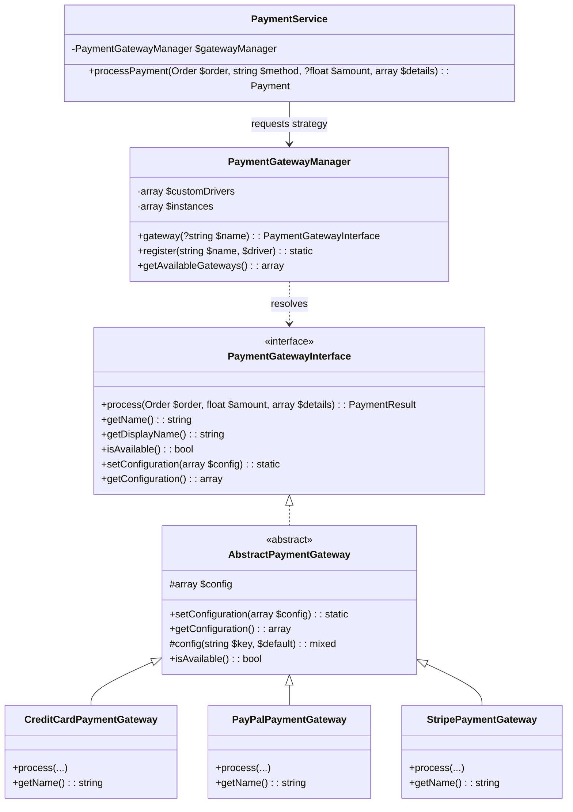

# Extendable Order & Payment Management API

[-brightgreen.svg)]()
[]()
[]()
[]()
[-purple.svg)]()

A robust, enterprise-ready RESTful API for managing orders and payments built with **Laravel 12**. Designed strictly around **clean code principles**, **PSR-12 standards**, **Service-Repository separation**, and the **Strategy Design Pattern** for seamless payment gateway extensibility.

> 📖 **Looking for a deep-dive explanation of what this project does and how it works under the hood?**  
> Check out the complete architectural guide in [PROJECT_EXPLANATION.md](PROJECT_EXPLANATION.md).

---

## Table of Contents

- [Deep-Dive Architecture & Explanation Guide](PROJECT_EXPLANATION.md)
- [Core Features](#core-features)
- [Architecture & Design Principles](#architecture--design-principles)
- [Payment Gateway Extensibility (Strategy Pattern)](#payment-gateway-extensibility-strategy-pattern)
  - [How It Works](#how-it-works)
  - [How to Add a New Payment Gateway (in 2 Minutes)](#how-to-add-a-new-payment-gateway-in-2-minutes)
  - [Configuration: .env vs Database](#configuration-env-vs-database)
- [Business Rules & Domain Constraints](#business-rules--domain-constraints)
- [Technology Stack](#technology-stack)
- [Installation & Quick Start](#installation--quick-start)
- [API Reference](#api-reference)
  - [Authentication](#1-authentication)
  - [Orders Management](#2-orders-management)
  - [Payments Management](#3-payments-management)
  - [Payment Gateways](#4-payment-gateways)
- [Testing](#testing)
- [Postman Collection & Documentation](#postman-collection--documentation)
- [Assumptions & Design Decisions](#assumptions--design-decisions)

---

## Core Features

- **Order Management**:
  - Create orders with customer details and line items (product name, quantity, unit price).
  - Automatic calculation of item subtotals and grand order total.
  - View all orders with pagination and filtering by status (`pending`, `confirmed`, `cancelled`).
  - View single order details with associated items and payments history.
  - Update order details (customer details, order status).
  - Delete orders protected by business rules.
- **Payment Management**:
  - Simulate payments against orders via distinct payment gateways (`credit_card`, `paypal`, `stripe`).
  - Strategy Pattern implementation ensuring zero controller modification when adding new gateways.
  - View paginated payments, single payment details, or payments for a specific order.
  - Gateway transaction reference, response payload, and failure auditing.
- **Authentication & Security**:
  - Stateless **JWT (JSON Web Token)** authentication (`php-open-source-saver/jwt-auth`).
  - User registration, login, token refresh, and logout endpoints.
  - Endpoints protected with `auth:api` middleware.
- **Validation & Exception Handling**:
  - Dedicated Form Request classes for every write endpoint.
  - Consistent JSON error envelopes for domain business rule violations, 404s, and 422 validation errors.

---

## Architecture & Design Principles

```
app/
├── Enums/                     # Backed string Enums (OrderStatus, PaymentStatus, PaymentMethod)
├── Exceptions/                # Domain-specific exceptions (BusinessRuleException, OrderDeletionException, etc.)
├── Http/
│   ├── Controllers/Api/       # Slim API controllers; delegates logic to Services
│   ├── Requests/              # Dedicated FormRequests for input validation & authorization
│   └── Resources/             # JsonResource classes for consistent API response representations
├── Models/                    # Eloquent models with typed relationships, scopes, and casts
└── Services/
    ├── Order/
    │   └── OrderService.php   # Encapsulates order creation, calculation, updates, and deletion rules
    └── Payment/
        ├── Contracts/
        │   └── PaymentGatewayInterface.php  # Strategy contract for all gateways
        ├── DTOs/
        │   └── PaymentResult.php            # Normalized value object for gateway responses
        ├── Gateways/
        │   ├── AbstractPaymentGateway.php   # Common configuration and lifecycle methods
        │   ├── CreditCardPaymentGateway.php # Credit card simulation strategy
        │   ├── PayPalPaymentGateway.php     # PayPal simulation strategy
        │   └── StripePaymentGateway.php     # Stripe simulation strategy
        ├── PaymentGatewayManager.php        # Strategy Registry / Context resolving drivers
        └── PaymentService.php               # High-level payment orchestration & transaction boundary
```

---

## Payment Gateway Extensibility (Strategy Pattern)

The system isolates payment processing logic using the **Strategy Pattern**. Controllers and higher-level domain services depend exclusively on the contract `PaymentGatewayInterface` rather than concrete gateway implementations.

### How It Works



1. **`PaymentGatewayInterface`**: Contract defining `process()`, `getName()`, `getDisplayName()`, and configuration setters.
2. **`AbstractPaymentGateway`**: Base class providing configuration handling and availability checks.
3. **`PaymentGatewayManager`**: Central Strategy Context & Factory. Resolves the requested gateway, merges `.env` configuration with dynamic database overrides, and caches instances.
4. **`PaymentResult`**: Normalized DTO returning status (`successful`, `failed`, `pending`), transaction ID, message, and raw payload.

---

### How to Add a New Payment Gateway (in 2 Minutes)

Adding a brand new payment gateway (e.g., `CryptoPaymentGateway`) requires **zero modifications** to controllers or existing payment processing code:

#### Step 1: Create the Gateway Class
Create `app/Services/Payment/Gateways/CryptoPaymentGateway.php`:

```php
namespace App\Services\Payment\Gateways;

use App\Models\Order;
use App\Services\Payment\DTOs\PaymentResult;
use Illuminate\Support\Str;

class CryptoPaymentGateway extends AbstractPaymentGateway
{
    public function getName(): string
    {
        return 'crypto';
    }

    public function getDisplayName(): string
    {
        return $this->config('display_name', 'Cryptocurrency');
    }

    public function process(Order $order, float $amount, array $details = []): PaymentResult
    {
        $walletAddress = $details['wallet_address'] ?? null;

        if (!$walletAddress) {
            return PaymentResult::failure('Wallet address is required for crypto payments.');
        }

        // Simulate blockchain transaction
        $txHash = '0x' . Str::random(64);

        return PaymentResult::success(
            transactionId: $txHash,
            message: 'Crypto payment confirmed on blockchain.',
            rawResponse: ['tx_hash' => $txHash, 'network' => 'Polygon']
        );
    }
}
```

#### Step 2: Register the Gateway
Option A — Via `config/payments.php`:
```php
'gateways' => [
    // ... existing gateways
    'crypto' => [
        'driver' => \App\Services\Payment\Gateways\CryptoPaymentGateway::class,
        'display_name' => 'Cryptocurrency (ETH / USDC)',
        'enabled' => env('PAYMENT_CRYPTO_ENABLED', true),
        'network' => env('PAYMENT_CRYPTO_NETWORK', 'polygon'),
    ],
],
```

Option B — Dynamically in any `ServiceProvider`:
```php
app(\App\Services\Payment\PaymentGatewayManager::class)->register(
    'crypto',
    \App\Services\Payment\Gateways\CryptoPaymentGateway::class
);
```

**That is all!** The new payment method is immediately available for orders:
```bash
POST /api/payments
{
    "order_id": 1,
    "payment_method": "crypto",
    "details": { "wallet_address": "0x71C...897" }
}
```

---

### Configuration: .env vs Database

The architecture supports dual configuration sources:
1. **`.env` Configuration (Static Defaults)**:
   API keys, secrets, and URLs can be configured directly in `.env`:
   ```dotenv
   DEFAULT_PAYMENT_GATEWAY=credit_card

   PAYMENT_CREDIT_CARD_ENABLED=true
   PAYMENT_CREDIT_CARD_API_KEY=mock_key
   PAYMENT_CREDIT_CARD_SECRET=mock_secret

   PAYMENT_PAYPAL_ENABLED=true
   PAYMENT_PAYPAL_CLIENT_ID=mock_client
   PAYMENT_PAYPAL_SECRET=mock_secret

   PAYMENT_STRIPE_ENABLED=true
   PAYMENT_STRIPE_SECRET_KEY=sk_test_...
   ```

2. **Database Configuration (`payment_gateways` table)**:
   Administrators can toggle gateways on/off or update API credentials live without redeploying code using `POST /api/payment-gateways`:
   ```json
   {
       "name": "paypal",
       "display_name": "PayPal Live",
       "is_active": false,
       "config": {
           "mode": "live",
           "client_id": "live_client_abc"
       }
   }
   ```
   If a gateway is set to `is_active: false` in the database, the API will refuse payment attempts with `422 Unprocessable Content`.

---

## Business Rules & Domain Constraints

1. **Order Confirmation Requirement**:
   > *Payments can only be processed for orders in the `confirmed` status.*
   - If an order is in `pending` or `cancelled` status, the payment request is rejected with `422 Unprocessable Content`:
   ```json
   {
       "success": false,
       "message": "Payments can only be processed for orders in the 'confirmed' status. Current order status is 'pending'."
   }
   ```

2. **Deletion Protection**:
   > *Orders cannot be deleted if they have associated payments.*
   - If an order has any associated payment records (successful or failed), `DELETE /api/orders/{id}` returns `422 Unprocessable Content`:
   ```json
   {
       "success": false,
       "message": "Order #ORD-20261020-0003 cannot be deleted because it has associated payments."
   }
   ```
   - Only orders with zero payments can be safely deleted.

3. **Item Modification Protection**:
   - Order items cannot be replaced or modified after payments have been logged against the order.

4. **Duplicate Payment Prevention**:
   - Fully paid orders reject additional payments to prevent overcharging.

---

## Technology Stack

- **Framework**: Laravel 12.x
- **PHP**: 8.2+
- **Authentication**: JWT (`php-open-source-saver/jwt-auth:^2.8`)
- **Database**: SQLite (default, self-contained) or MySQL/PostgreSQL
- **Testing**: PHPUnit 11.5 / Laravel Testing Suite
- **Code Linter**: Laravel Pint (PSR-12 strict)

---

## Installation & Quick Start

### 1. Clone the repository
```bash
git clone <repository_url>
cd <repository_folder>
```

### 2. Install PHP dependencies
```bash
composer install
```

### 3. Configure Environment
```bash
cp .env.example .env
php artisan key:generate
php artisan jwt:secret --force
```

### 4. Database Setup & Seeding
By default, the application is pre-configured with SQLite:
```bash
touch database/database.sqlite
php artisan migrate --seed
```

> **Pre-seeded Demo User:**
> - **Email**: `admin@example.com`
> - **Password**: `password123`

### 5. Start Development Server
```bash
php artisan serve
```
The API is now running at `http://127.0.0.1:8000/api`.

---

## API Reference

All requests must include `Accept: application/json`. Protected endpoints require `Authorization: Bearer <token>`.

### 1. Authentication

| Method | Endpoint | Auth | Description |
|---|---|---|---|
| `POST` | `/api/auth/register` | Public | Register a new user |
| `POST` | `/api/auth/login` | Public | Authenticate user & receive JWT token |
| `GET` | `/api/auth/me` | Bearer | Get current user profile |
| `POST` | `/api/auth/refresh` | Bearer | Refresh JWT token |
| `POST` | `/api/auth/logout` | Bearer | Invalidate JWT token |

#### Register User
```http
POST /api/auth/register
Content-Type: application/json

{
    "name": "Jane Doe",
    "email": "jane@example.com",
    "password": "password123",
    "password_confirmation": "password123"
}
```

#### Login
```http
POST /api/auth/login
Content-Type: application/json

{
    "email": "admin@example.com",
    "password": "password123"
}
```

---

### 2. Orders Management

| Method | Endpoint | Auth | Description |
|---|---|---|---|
| `GET` | `/api/orders` | Bearer | List orders (paginated, filterable by `?status=`) |
| `POST` | `/api/orders` | Bearer | Create order with items & calculate total |
| `GET` | `/api/orders/{id}` | Bearer | View single order with items & payments |
| `PUT` | `/api/orders/{id}` | Bearer | Update order details / status |
| `DELETE` | `/api/orders/{id}` | Bearer | Delete order (only if zero payments exist) |
| `GET` | `/api/orders/{id}/payments` | Bearer | Retrieve all payments for an order |

#### Create Order
```http
POST /api/orders
Authorization: Bearer <token>
Content-Type: application/json

{
    "customer_name": "Alice Johnson",
    "customer_email": "alice@example.com",
    "customer_phone": "+1-555-0101",
    "shipping_address": "123 Market St, San Francisco, CA",
    "notes": "Fragile items",
    "items": [
        {
            "product_name": "Mechanical Keyboard RGB",
            "quantity": 1,
            "price": 129.99
        },
        {
            "product_name": "Desk Mousepad XL",
            "quantity": 2,
            "price": 24.99
        }
    ]
}
```

*Response (201 Created):*
```json
{
    "success": true,
    "message": "Order created successfully.",
    "data": {
        "id": 1,
        "order_number": "ORD-20261020-A1B2C3D4",
        "customer_name": "Alice Johnson",
        "customer_email": "alice@example.com",
        "status": "pending",
        "total_amount": 179.97,
        "paid_amount": 0.00,
        "is_fully_paid": false,
        "items": [
            {
                "product_name": "Mechanical Keyboard RGB",
                "quantity": 1,
                "price": 129.99,
                "subtotal": 129.99
            },
            {
                "product_name": "Desk Mousepad XL",
                "quantity": 2,
                "price": 24.99,
                "subtotal": 49.98
            }
        ]
    }
}
```

---

### 3. Payments Management

| Method | Endpoint | Auth | Description |
|---|---|---|---|
| `GET` | `/api/payments` | Bearer | List all payments (paginated, filterable) |
| `POST` | `/api/payments` | Bearer | Process payment for an order |
| `GET` | `/api/payments/{id}` | Bearer | View single payment details |

#### Process Payment
```http
POST /api/payments
Authorization: Bearer <token>
Content-Type: application/json

{
    "order_id": 2,
    "payment_method": "credit_card",
    "amount": 299.00,
    "details": {
        "card_number": "4111111111114242",
        "exp_month": "12",
        "exp_year": "2028",
        "cvv": "123"
    }
}
```

*Supported `payment_method` options*:
- `credit_card`: Card ending in `0000` or flag `"simulate_failure": true` triggers decline.
- `paypal`: Payer email containing `fail` or flag `"simulate_failure": true` triggers decline.
- `stripe`: Method ID `tok_chargeDeclined` or `"simulate_failure": true` triggers decline.

---

### 4. Payment Gateways

| Method | Endpoint | Auth | Description |
|---|---|---|---|
| `GET` | `/api/payment-gateways` | Bearer | List available payment gateways |
| `POST` | `/api/payment-gateways` | Bearer | Update / enable / disable gateway config in DB |

---

## Testing

The test suite covers unit and feature tests with **100% test pass rate**:
- Gateway Strategy resolution and custom extension tests.
- Concrete gateway processing and simulation tests (Credit Card, PayPal, Stripe).
- Order total calculation and item subtotal tests.
- Business rule enforcement (confirmation check, deletion protection).
- Authentication flow (Register, Login, Refresh, Me, Logout).
- Full API lifecycle feature tests.

Run tests:
```bash
php artisan test
```

Run code style check (PSR-12):
```bash
./vendor/bin/pint --test
```

---

## Postman Collection & Documentation

A ready-to-import Postman Collection v2.1.0 and Environment file are included in the repository root:
- **Collection**: [`Test Task.postman.json`](Test%20Task.postman.json) or [`postman_collection.json`](postman_collection.json)
- **Environment**: [`postman_environment.json`](postman_environment.json)

### How to Import:
1. Open Postman.
2. Click **Import** in the top-left corner.
3. Select both `postman_collection.json` and `postman_environment.json`.
4. Select the **Order & Payment API - Local** environment.
5. Execute the **Login** or **Register User** request. The test script will automatically extract the JWT token and set the `jwt_token` environment variable for all subsequent requests!

---

## Assumptions & Design Decisions

1. **Order Totals Calculation**:
   - Order total is calculated directly from line items (`quantity * price`).
   - Rounding is performed to 2 decimal places using standard financial decimal conventions.
2. **Order Statuses**:
   - An order begins in `pending` status.
   - It must be transitioned to `confirmed` status before payment can be accepted.
3. **Stateless JWT**:
   - JWT tokens are issued with a default TTL of 60 minutes.
   - Token refresh and blacklist logout are fully supported.
4. **Database-Driven Gateway Fallback**:
   - If a gateway entry exists in the `payment_gateways` database table, its active status and configuration take precedence over `.env` defaults. If no record exists, the system seamlessly falls back to `.env` configuration.
# Order-Payment-API-Task
